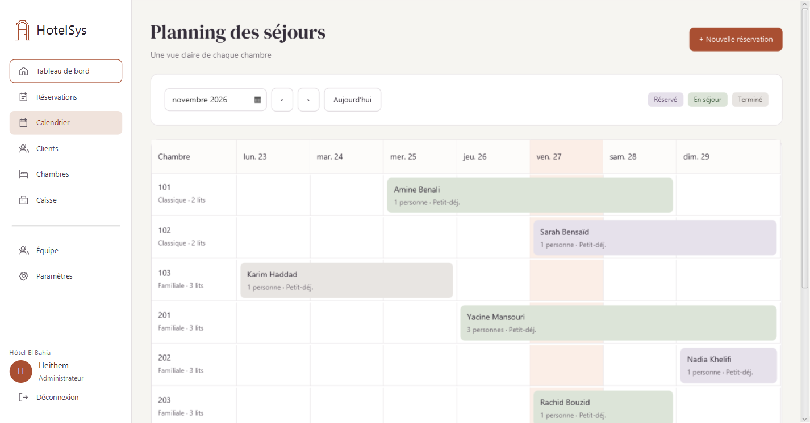

# HotelSys

Application JavaFX en français pour gérer la réception d'un hôtel : chambres, clients, réservations, planning, équipe et caisse. Conçue pour un établissement et un poste de réception local.



## Lancer

**JDK 21 requis.** Il est déjà installé pour cet utilisateur Windows. Double-cliquez sur `run.cmd`, ou lancez depuis le dossier du projet :

```powershell
.\run.cmd
```

Au premier lancement uniquement, renseignez le nom de l'hôtel, son classement dans la liste à étoiles, les services de restauration proposés et le nom/mot de passe de l'administrateur. Choisissez un mot de passe de 12 caractères minimum.

Les ouvertures suivantes affichent la connexion : sélectionnez **Administrateur** ou **Employé**, votre nom, puis saisissez votre mot de passe. L'administrateur crée et modifie les comptes du personnel. Il n'y a aucun compte par défaut ni générateur de données dans l'application. Toutes les données de l'application restent dans **`data/hotelsys.db`**.

Si un terminal était ouvert avant l'installation de Java :

```powershell
$env:JAVA_HOME = [Environment]::GetEnvironmentVariable('JAVA_HOME', 'User')
```

Le premier build télécharge Maven et les dépendances. Ensuite, la réception et ses données fonctionnent hors connexion. Une ancienne installation Java peut encore répondre à `java -version` ; `run.cmd` et Maven utilisent le JDK défini par `JAVA_HOME`.

## Ce qui fonctionne

| Écran | Fonctionnalités |
|---|---|
| Connexion | Premier administrateur, mots de passe hachés, comptes actifs, déconnexion |
| Tableau de bord | Période au choix, ventes de séjours, occupation réservée, prix moyen, RevPAR, encaissements, dépenses, flux net, chambres performantes et soldes ouverts |
| Réservations | Recherche, devis, plusieurs chambres avec dates indépendantes, occupants et repas par chambre, modification avant arrivée |
| Dossier de séjour | Prix et solde, contrôle familial, arrivée, départ, annulation et accès au paiement |
| Calendrier | Semaine par chambre, navigation et choix de date, états colorés, ouverture des dossiers |
| Clients | Création, recherche et correction des identités, documents, dates de naissance et coordonnées |
| Chambres | Création/modification de chambres et modèles, équipements, prix, activation, suppression sans historique |
| Caisse | Fond initial, paiements partiels, remboursements, dépenses, historique, clôture et écart compté |
| Équipe | Création, rôles, changement de mot de passe et désactivation des comptes |
| Paramètres | Classement à étoiles, restauration, seuils enfants, son des paiements et réduction des animations |

Les employés assurent la réception et leur caisse. L'administrateur contrôle aussi les comptes, modèles, tarifs, paramètres, remboursements, dépenses et statistiques financières. Le dernier administrateur actif reste protégé.

## Quelques règles importantes

- Le titulaire doit avoir 19 ans pour un homme, 21 pour une femme : politique de projet demandée, sans qualification juridique.
- Les nouveaux clients adultes doivent avoir un numéro de document d'identité ; les documents sont facultatifs pour les mineurs. Les zéros initiaux sont conservés. Téléphones, montants et capacités ont des filtres de saisie.
- Les services de restauration se règlent au niveau de l'hôtel. Un service désactivé n'est plus proposé sur un nouveau devis ; les repas déjà convenus sont conservés.
- L'hébergement est au **prix fixe de la chambre par nuit**, sans remise enfant.
- Par défaut, un enfant de moins de 6 ans partage sans lit ; à partir de 6 ans, il nécessite un lit. La limite d'enfants sans lit est propre au modèle.
- Les repas s'appliquent à toute la chambre et se facturent par personne/nuit. Le modèle définit un prix enfant fixe ou une remise ; le seuil enfant vaut 12 ans par défaut.
- Les prix acceptés sont sauvegardés. Modifier le catalogue ne change pas une réservation existante. Une modification du séjour demande un nouveau devis et renouvelle son contrôle familial.
- Une chambre mixte exige une vérification familiale avant l'arrivée ; seule la trace du contrôle est conservée.
- Les chambres et occupants ne peuvent avoir deux séjours simultanés. Un départ et une nouvelle arrivée le même jour sont autorisés.
- Les corrections de naissance/sexe liées à un séjour actif sont bloquées pour préserver les conditions acceptées ; corrigez d'abord le séjour concerné.
- Une annulation conserve les paiements. Le remboursement se fait séparément dans une caisse ouverte.

## Choix techniques

Java 21, JavaFX 21, SQLite/JDBC, Maven Wrapper et CSS. Des classes JavaFX directes évitent une seconde couche de contrôleurs FXML. `HotelStore` contient les règles métier ; `Db` gère les requêtes préparées et transactions. Les opérations de données passent par un thread de travail, sans bloquer l'interface.

La police **Manrope**, les titres **DM Serif Display**, le logo et le thème terre cuite/porcelaine sont embarqués. Aucune police n'est installée sur Windows. Le calendrier reprend la [maquette générée](docs/design/calendar-reference.png) ; les textes et séjours restent de vrais contrôles JavaFX.

```text
src/main/java/com/hotelsys/
├── app/           # Lancement, shell et tâches en arrière-plan
├── model/         # User, Row, StayDraft
├── repository/    # Db : SQLite, migrations, transactions
├── service/       # HotelStore, Passwords
└── ui/            # Pages JavaFX et composants simples
src/main/resources/
├── db/migrations/ # SQL canonique
├── css/           # Palette et styles
├── fonts/         # Polices et licences OFL
└── images/        # Logo transparent
src/test/java/     # Neuf vérifications métier, fixtures isolées et passage graphique
docs/             # Besoins, architecture, dictionnaire, UML et conception visuelle
```

## Vérifier

```powershell
.\mvnw.cmd -B -ntp clean verify

# Facultatif, avec affichage graphique et données temporaires :
powershell -NoProfile -ExecutionPolicy Bypass -File .\scripts\check-ui.ps1
```

Neuf tests regroupent les scénarios importants : réservation/admission/paiement, enfants et lits, conflits et prix historiques, droits par rôle, remboursements, documents, restauration, calculs statistiques et migration des données. La compilation traite les avertissements comme des erreurs. Le passage graphique vérifie la configuration unique, la connexion par rôle/nom, les pages, un document avec zéro initial et une réservation persistée. Ses données synthétiques restent dans `target/ui-check` et ne sont pas distribuées dans l'application.

La mise à niveau d'une ancienne base crée automatiquement une sauvegarde dans `data/backups` avant la migration. Le son de confirmation est un court WAV original embarqué ; il est joué uniquement après un paiement enregistré et peut être désactivé.

Les statistiques de ventes concernent les nuits réservées de la période, hors annulations. Les encaissements nets correspondent aux paiements moins remboursements. Le flux net déduit les dépenses ; il ne prétend pas représenter un bénéfice comptable. Les soldes ouverts affichent les créances actuelles de tous les dossiers.

## Documents

- [Besoins et règles métier](docs/requirements.md)
- [Architecture et décisions](docs/architecture.md)
- [Dictionnaire et relations de la base](docs/database.md)
- [Diagrammes UML](docs/uml/README.md)
- [Schéma SQL](src/main/resources/db/migrations/001_initial.sql)
- [Direction visuelle et crédits](docs/design/direction.md)

Pour sauvegarder : fermez toutes les instances puis copiez `data/hotelsys.db`. Pour restaurer, conservez une copie du fichier actuel avant de le remplacer, application fermée. Données, mots de passe, caches et builds ne sont pas suivis dans Git.

Le périmètre reste un poste local : pas de cloud, synchronisation réseau, installateur Windows ni comptabilité générale.
