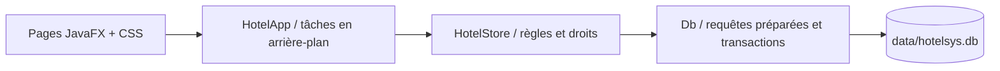

# Architecture de HotelSys

## Une application de bureau locale

Le projet utilise un seul module Maven. `HotelApp` gère le démarrage, la navigation et un exécuteur à un thread. Les pages produisent leurs contrôles en Java ; CSS porte la présentation. Les opérations SQLite et le hachage des mots de passe s'exécutent hors du thread graphique.

## Classes et responsabilités

| Élément | Fonction |
|---|---|
| `Launcher`, `HotelApp` | Point d'entrée, environnement, shell, navigation, tâches et retour utilisateur |
| `User`, `StayDraft`, `Row` | Compte connecté, demande immuable de séjour et résultats en lecture |
| `Db` | Connexions, paramètres SQLite, migration et transactions |
| `HotelStore` | Authentification, catalogue, personnes, réservations, admission, caisse et statistiques |
| `Passwords` | PBKDF2, sel aléatoire et vérification des empreintes |
| `DemoData` | Exemple synthétique facultatif sur une base vide |
| Pages de `ui` | Formulaires et affichage ; aucune requête SQL |
| `UI`, `Icons` | Contrôles partagés, formatage, dialogues et tracés homogènes |

Le service reste concret pour ce mini-projet. Les modules pourront être séparés si leur taille le justifie ; aucune interface ou architecture de serveur n'est nécessaire ici.

## Réservation et tarification

`StayDraft` décrit chambre, dates, occupants et repas. `quote` vérifie titulaire, disponibilité, capacité et catégories d'âge. Il renvoie un total et le détail par chambre. `book` refait les contrôles dans une transaction d'écriture, compare au devis accepté et sauvegarde toutes les lignes ensemble.

`updateStay` ne modifie que les séjours réservés, recalcule explicitement les tarifs courants et renouvelle la vérification familiale. Un séjour commencé conserve sa chambre, ses occupants, ses dates et son prix. Les corrections de naissance/sexe d'une personne impliquée dans une réservation active sont bloquées ; les coordonnées restent modifiables.

Les montants sont des `long` en centimes. `Math.addExact` et `Math.multiplyExact` évitent les débordements silencieux dans les devis. Les pourcentages utilisent `BigDecimal` et `HALF_UP`. Les vues SQL calculent totaux, soldes et écarts sans compteurs dupliqués.

## Persistance et sécurité

- Fichier local `data/hotelsys.db`, ou dossier isolé via la propriété JVM `hotelsys.dataDir`.
- Chaque connexion active les clés étrangères et attend au maximum cinq secondes en cas d'écriture concurrente.
- Transactions `IMMEDIATE` : disponibilité et écriture sont sérialisées. Une erreur annule toute l'opération.
- Le script initial est exécuté entier, sans découpage sur `;`, car il contient des triggers.
- `user_version` passe à 1 seulement après réussite. Une base plus récente est refusée ; un redémarrage conserve les données.
- Les autorisations relisent le rôle et l'état actif de l'utilisateur dans la base. Les menus administrateur ne sont qu'une aide d'affichage.
- Mots de passe : PBKDF2-HMAC-SHA256, 600 000 itérations, sel aléatoire de 16 octets, empreinte de 32 octets, format versionné et comparaison constante.
- Dates en `LocalDate`, calcul métier en `Africa/Algiers`, événements UTC à précision fixe de trois décimales.
- Les contrôles familiaux ne stockent ni scans ni numéros de documents.
- Les erreurs techniques sont consignées dans `data/hotelsys.log`, avec un message utilisateur français.

Le fichier dépend des permissions du compte Windows ; l'application ne le chiffre pas. La sauvegarde se fait application fermée, avec le journal SQLite standard.

## Design et vérification

Le thème et les polices sont embarqués ; aucune modification des polices système n'est nécessaire. La porte arquée est la signature de l'application. Les transitions utilisent une seule courbe, un fondu et un déplacement de 8 px ; elles peuvent être réduites depuis les paramètres.

Six scénarios JUnit vérifient les règles essentielles sur des bases temporaires. `UiCheck`, facultatif, ouvre l'application sur un exemple isolé, parcourt les pages, crée une réservation et vérifie la reconnexion. Les captures sont des rendus de vrais contrôles JavaFX.

## Références

[JavaFX](https://openjfx.io/openjfx-docs/), [Maven Wrapper](https://maven.apache.org/tools/wrapper/), [SQLite local](https://sqlite.org/whentouse.html), [tables STRICT](https://sqlite.org/stricttables.html), [clés étrangères](https://sqlite.org/foreignkeys.html), [index partiels](https://sqlite.org/partialindex.html).
