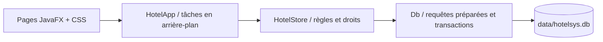

# Architecture de HotelSys

## Une application de bureau locale

Le projet utilise un seul module Maven. `HotelApp` gère le démarrage, la navigation et un exécuteur à un thread. Les pages produisent leurs contrôles en Java ; CSS porte la présentation. Les opérations SQLite et le hachage des mots de passe s'exécutent hors du thread graphique.

## Classes et responsabilités

| Élément | Fonction |
|---|---|
| `Launcher`, `HotelApp` | Point d'entrée, environnement, shell, navigation, tâches et retour utilisateur |
| `User`, `StayDraft`, `Row` | Compte connecté, demande immuable de séjour et résultats en lecture |
| `Db` | Connexions, paramètres SQLite, migration et transactions |
| `HotelStore` | Authentification, catalogue, personnes, réservations, admission, caisse et statistiques |
| `Passwords` | PBKDF2, sel aléatoire et vérification des empreintes |
| `PaymentSound` | Confirmation sonore facultative après validation du paiement |
| Pages de `ui` | Formulaires et affichage ; aucune requête SQL |
| `UI`, `Icons` | Contrôles partagés, formatage, dialogues et tracés homogènes |

Le service reste concret pour ce mini-projet. Les modules pourront être séparés si leur taille le justifie ; aucune interface ou architecture de serveur n'est nécessaire ici.

## Réservation et tarification

`StayDraft` décrit chambre, dates/heures, occupants et repas. `quote` vérifie titulaire, disponibilité, capacité et catégories d'âge. Il renvoie un total et le détail par chambre. `book` refait les contrôles dans une transaction d'écriture, compare au devis accepté et sauvegarde toutes les lignes avec leur encaissement automatique dans une même transaction.

`updateStay` ne modifie que les séjours réservés, recalcule automatiquement les tarifs courants et renouvelle la vérification familiale. Un séjour commencé conserve sa chambre, ses occupants, son arrivée et son prix. `extendStay` peut prolonger son départ si les trois heures de préparation et les autres réservations le permettent. Les corrections de naissance/sexe d'une personne impliquée dans une réservation active sont bloquées ; les coordonnées restent modifiables.

Les montants sont des `long` en centimes. `Math.addExact` et `Math.multiplyExact` évitent les débordements silencieux dans les devis. Les nouveaux repas ont un tarif global par personne. Les anciennes remises restent dans les instantanés historiques. Les vues SQL calculent totaux, soldes et écarts sans compteurs dupliqués.

## Persistance et sécurité

- Fichier local `data/hotelsys.db`, ou dossier isolé via la propriété JVM `hotelsys.dataDir`.
- Chaque connexion active les clés étrangères et attend au maximum cinq secondes en cas d'écriture concurrente.
- Transactions `IMMEDIATE` : disponibilité et écriture sont sérialisées. Une erreur annule toute l'opération.
- Le script initial est exécuté entier, sans découpage sur `;`, car il contient des triggers.
- Une seule migration, `001_initial.sql`, crée le schéma complet au format `user_version=5`. Les bases en version 4 reçoivent les règles de disponibilité dans une transaction. Les versions 1–3 sont converties directement vers le schéma canonique, avec contrôle des références et annulation en cas d’erreur. Une sauvegarde SQLite cohérente est créée avant la mise à niveau d'une ancienne base. Une base plus récente est refusée ; un redémarrage conserve les données.
- Les autorisations relisent le rôle et l'état actif de l'utilisateur dans la base. Les menus administrateur ne sont qu'une aide d'affichage.
- Mots de passe : PBKDF2-HMAC-SHA256, 600 000 itérations, sel aléatoire de 16 octets, empreinte de 32 octets, format versionné et comparaison constante.
- Dates en `LocalDate`, heures en `LocalTime`, calcul métier en `Africa/Algiers`, événements UTC à précision fixe de trois décimales.
- Les contrôles familiaux ne stockent ni scans ni numéros de documents.
- Les erreurs techniques sont consignées dans `data/hotelsys.log`, avec un message utilisateur français.

Le fichier dépend des permissions du compte Windows ; l'application ne le chiffre pas. La sauvegarde se fait application fermée, avec le journal SQLite standard.

## Design et vérification

Le thème utilise Segoe UI pour les contrôles et DM Serif Display pour les titres et les numéros de chambre. Les transitions utilisent un fondu et un déplacement de 4 px. Leur réduction est accessible dans Paramètres.

Le mode `--seed-demo` ajoute des données fictives à une base configurée après sauvegarde. Les lignes de démonstration sont identifiables dans la réservation et dans le journal de caisse.

Les comptes utilisent un identifiant interne stable, jamais demandé à l'utilisateur. L’administrateur saisit son nom ; les réceptionnistes sélectionnent leur compte. La connexion vérifie nom/compte, rôle, activation et mot de passe. Changer le rôle dans l'interface n'accorde aucun droit.

Les filtres JavaFX restreignent la saisie ; HotelStore valide de nouveau les valeurs avant écriture. Les numéros de document sont textuels et uniques par type, pour préserver les zéros initiaux. Les colonnes d'identité d'anciens clients restent vides après migration, sans inventer de document.

## Références

[JavaFX](https://openjfx.io/openjfx-docs/), [Maven Wrapper](https://maven.apache.org/tools/wrapper/), [SQLite local](https://sqlite.org/whentouse.html), [tables STRICT](https://sqlite.org/stricttables.html), [clés étrangères](https://sqlite.org/foreignkeys.html), [index partiels](https://sqlite.org/partialindex.html).

## Contrôles et interactions

Les listes déroulantes et le menu des occupants utilisent les contrôles JavaFX standards avec le thème CSS commun. `CalendarSkin` affiche le sélecteur de date. `DateEntry` filtre les chiffres, pose les séparateurs et reconnaît une saisie comme `2892004` comme `28/09/2004`, sans accepter un jour ou un mois invalide. `Motion` partage les durées et la courbe des animations et respecte la réduction des mouvements.

`BookingEditor` relance le calcul dès la modification et ignore les réponses périmées. Le planning charge les séjours une fois à l’ouverture et affiche cinq semaines à partir du lundi choisi. La confirmation valide à nouveau les règles en transaction et encaisse le total. Une nouvelle caisse à fond nul s’ouvre si nécessaire ; la caisse d’un autre réceptionniste provoque un rollback complet. Les alertes du tableau de bord se rafraîchissent toutes les 30 secondes ; leur timer s’arrête en quittant la page.

`KeysDialog` permet de choisir chambre, personne et sens des clés. Il suggère le départ définitif à partir de trois heures avant le départ prévu. Le service vérifie l’occupant, l’état du séjour et le dernier mouvement ; une clôture sur des clés déjà déposées est permise. `PeoplePage` affiche l’historique par séjour/chambre, avec tous les acteurs et personnes concernés.

La [direction visuelle](design/direction.md) présente le thème et l’historique des maquettes.
