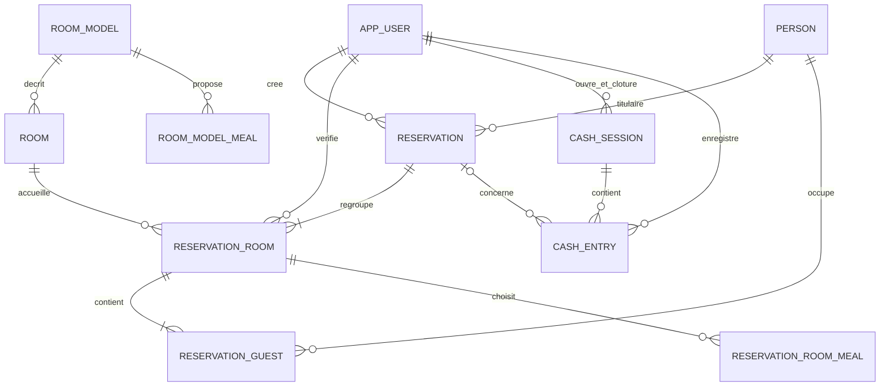

# Architecture détaillée de la base

## Vue d'ensemble

Le schéma comprend **12 tables métier et 3 vues calculées**. Sa source unique est [001_initial.sql](../src/main/resources/db/migrations/001_initial.sql). Les données se répartissent en catalogue, personnes/comptes, réservations et caisse.



`hotel` est une configuration unique, `id=1`. Les chambres appartiennent implicitement à cet hôtel ; répéter `hotel_id` dans les autres tables ne servirait pas le périmètre mono-hôtel.

Les cardinalités minimales « au moins une chambre » et « au moins un occupant » sont vérifiées au niveau de la transaction de réservation. Le SQL interdit déjà l'arrivée sans occupant. Les cardinalités maximales et les références sont protégées dans la base.

## Conventions de stockage

| Convention | Règle |
|---|---|
| Identifiants | `INTEGER PRIMARY KEY` ; allocation SQLite, sans `AUTOINCREMENT` inutile |
| Montants | `INTEGER` en centimes DZD : `100000` signifie `1 000,00 DZD` |
| Dates | `TEXT` ISO `YYYY-MM-DD`, format et date calendaire vérifiés |
| Événements | UTC, format fixe recommandé `YYYY-MM-DDTHH:mm:ss.SSSZ` |
| Booléens | `INTEGER` limité à `0` ou `1` |
| Codes | `TEXT` avec `CHECK`, sans tables de référence pour trois valeurs fixes |
| Champs facultatifs | Texte vide pour téléphone, e-mail et notes ; `NULL` pour événement/relation absent |
| Types | Toutes les tables sont `STRICT` |

Les noms ne sont pas uniques : deux personnes peuvent partager nom et naissance. Les identifiants de compte, numéros de chambre et noms de modèle sont uniques sans distinction de casse ASCII (`NOCASE`). Les identifiants de compte sont limités aux caractères ASCII pour une normalisation prévisible.

## Dictionnaire des tables

### `hotel` — configuration du seul hôtel

| Champ | Type / contrainte | Signification |
|---|---|---|
| `id` | PK, toujours `1` | Une seule configuration |
| `name` | TEXT, 1–150 caractères | Nom de l'hôtel |
| `category` | TEXT, 1–80 caractères | Catégorie de l'énoncé |
| `bed_sharing_age` | INTEGER, 0–18, défaut 6 | Les personnes strictement plus jeunes peuvent partager sans lit |
| `meal_child_age` | INTEGER, 0–18, défaut 12 | Seuil strict du tarif enfant des repas |

La migration crée uniquement cette configuration initiale, à personnaliser plus tard. Elle ne crée aucun compte ni client.

### `room_model` — modèle de chambre

| Champ | Type / contrainte | Signification |
|---|---|---|
| `id` | PK | Identifiant |
| `name` | TEXT UNIQUE, 1–80 | Ex. A, B, Familiale |
| `bed_count` | INTEGER > 0 | Places nécessitant un lit |
| `max_sharing_children` | INTEGER ≥ 0, défaut 1 | Nombre maximal d'enfants sans lit |
| `facilities` | TEXT, ≤ 2 000 | Équipements décrits une fois pour ce modèle |

Les équipements restent descriptifs : aucune recherche par équipement n'est demandée, donc un catalogue et une table de liaison supplémentaires ne sont pas nécessaires.

### `room_model_meal` — tarifs courants des repas

| Champ | Type / contrainte | Signification |
|---|---|---|
| `model_id` | FK → `room_model` | Modèle concerné |
| `meal` | `BREAKFAST`, `LUNCH`, `DINNER` | Repas proposé |
| `adult_price` | INTEGER ≥ 0 | Prix par adulte et par nuit |
| `child_fixed_price` | INTEGER ≥ 0, nullable | Prix enfant explicite |
| `child_discount_percent` | INTEGER 0–100, nullable | Réduction enfant sur le prix adulte |

PK composite : `(model_id, meal)`. **Exactement un** des deux réglages enfant est renseigné. Une remise de 100 % ou un prix fixe nul permet la gratuité. L'absence de ligne signifie que le repas n'a pas encore de tarif et ne doit pas être proposé à la réservation.

### `room` — chambre physique

| Champ | Type / contrainte | Signification |
|---|---|---|
| `id` | PK | Identifiant |
| `number` | TEXT UNIQUE, 1–20 | Numéro affiché |
| `model_id` | FK → `room_model` | Lits, allowance et équipements |
| `nightly_price` | INTEGER ≥ 0 | Prix fixe de toute la chambre pour une nuit |
| `active` | 0/1, défaut 1 | Autorise les nouvelles réservations |

Le modèle ne contient pas de prix d'hébergement dupliqué : le prix courant appartient à la chambre, conformément au choix retenu.

### `person` — identité d'un client ou accompagnant

| Champ | Type / contrainte | Signification |
|---|---|---|
| `id` | PK | Identité réutilisable entre séjours |
| `last_name`, `first_name` | TEXT, 1–100 chacun | Nom et prénom |
| `birth_date` | Date ISO valide | Sert aux règles d'âge |
| `sex` | `MALE` / `FEMALE` | Politique d'admission demandée |
| `phone`, `email` | TEXT, facultatifs | Contact, limites 40/200 caractères |

Aucune colonne `age`, `is_adult` ou table séparée adulte/enfant : ces catégories dépendent de la date et de la règle appliquée. L'éligibilité du titulaire (19/21), le besoin d'un lit (6) et le tarif enfant des repas (12) sont trois notions distinctes.

### `app_user` — comptes du personnel

| Champ | Type / contrainte | Signification |
|---|---|---|
| `id` | PK | Compte référencé par les actions |
| `display_name` | TEXT, 1–100 | Nom affiché |
| `username` | TEXT UNIQUE, 3–40 | Identifiant normalisé par HotelStore |
| `password_hash` | TEXT, obligatoire | Empreinte versionnée, jamais le mot de passe |
| `role` | `ADMIN` / `WORKER` | Rôle applicatif |
| `active` | 0/1 | Compte utilisable |
| `created_at` | UTC, défaut SQLite | Création |

Les employés ne sont pas assimilés aux clients : leurs comptes n'ont pas besoin de naissance ni de sexe. Les triggers empêchent de supprimer, désactiver ou rétrograder le dernier administrateur actif.

### `reservation` — dossier commun

| Champ | Type / contrainte | Signification |
|---|---|---|
| `id` | PK | Référence simple du dossier |
| `holder_id` | FK → `person` | Responsable éligible à la réservation |
| `created_by` | FK → `app_user` | Employé ayant créé le dossier |
| `booked_at` | UTC obligatoire | Instant de réservation |
| `notes` | TEXT, ≤ 2 000 | Informations communes |

Les dates et états ne sont pas répétés ici : les chambres du même dossier peuvent arriver et partir à des dates différentes. Les limites globales se déduisent de leurs lignes.

### `reservation_room` — séjour d'une chambre

| Champ | Type / contrainte | Signification |
|---|---|---|
| `id` | PK | Identifie précisément une période dans une chambre |
| `reservation_id` | FK → `reservation` | Dossier parent |
| `room_id` | FK → `room` | Chambre physique |
| `arrival`, `departure` | Dates valides, départ > arrivée | Intervalle `[arrivée, départ[` |
| `status` | `RESERVED`, `CHECKED_IN`, `CHECKED_OUT`, `CANCELLED` | État indépendant de la ligne |
| `nightly_price` | INTEGER ≥ 0 | Prix d'hébergement accepté |
| `bed_count`, `max_sharing_children` | Capacité sauvegardée | Conditions acceptées à la réservation |
| `bed_sharing_age`, `meal_child_age` | Seuils sauvegardés | Protègent le contrat des changements futurs |
| `family_basis` | Nullable : `SPOUSES`, `BLOOD_RELATIVES`, `MIXED_FAMILY` | Relation vérifiée pour le groupe |
| `family_document` | Nullable : livret, mariage, naissance, autre | Type de preuve présentée |
| `family_note` | TEXT, ≤ 500 | Précision ; requise pour le type `OTHER` |
| `verified_by`, `verified_at` | FK employé + UTC, nullables | Trace du contrôle |
| `checked_in_at`, `checked_out_at` | UTC, nullables | Événements réels |

Les quatre éléments essentiels de vérification sont tous renseignés ou tous absents. Les timestamps d'arrivée/départ correspondent à l'état. Les dates, chambre, politiques et prix d'un séjour commencé ne peuvent plus être modifiés.

L'identifiant de ligne est nécessaire : la même chambre peut figurer à deux périodes distinctes dans un dossier. Une clé seulement composée de réservation/chambre empêcherait ce cas.

### `reservation_guest` — occupants du séjour

| Champ | Type / contrainte | Signification |
|---|---|---|
| `reservation_room_id` | FK → `reservation_room` | Séjour occupé |
| `person_id` | FK → `person` | Occupant nommé |
| `requires_bed` | 0/1 | Catégorie sauvegardée à l'arrivée prévue |
| `meal_tariff` | `ADULT` / `CHILD` | Catégorie tarifaire sauvegardée |

PK composite : `(reservation_room_id, person_id)`. Pas de `reservation_id`, `room_id` ni de coordonnées copiées : ces données sont accessibles par les relations existantes. Les catégories sauvegardées préservent les conditions historiques ; elles doivent être recalculées et validées par les services de HotelStore lors de corrections avant arrivée.

### `reservation_room_meal` — sélection et prix convenus

| Champ | Type / contrainte | Signification |
|---|---|---|
| `reservation_room_id` | FK → `reservation_room` | Séjour bénéficiaire |
| `meal` | Un des trois repas | La présence de la ligne est le « switch activé » |
| `adult_price`, `child_price` | INTEGER ≥ 0 | Prix effectifs convenus, après remise éventuelle |

PK composite : `(reservation_room_id, meal)`. Les repas sont associés à la chambre réservée, pas à une personne. Le calcul applique le prix adulte/enfant aux occupants de cette chambre. Stocker les deux prix effectifs suffit pour préserver la facture ; aucune table de repas servis par date n'est nécessaire.

### `cash_session` — ouverture et clôture de caisse

| Champ | Type / contrainte | Signification |
|---|---|---|
| `id` | PK | Session |
| `opened_by`, `opened_at` | FK employé + UTC | Ouverture |
| `opening_float` | INTEGER ≥ 0 | Fond initial |
| `closed_by`, `closed_at` | FK employé + UTC, nullables | Clôture, éventuellement par admin |
| `counted_cash` | INTEGER ≥ 0, nullable | Espèces réellement comptées |
| `closing_note` | TEXT, ≤ 1 000 | Explication d'écart ou de clôture |

Les trois données de clôture sont présentes ensemble ou absentes ensemble. Une seule session peut rester ouverte. Le fond, l'auteur et l'instant d'ouverture sont immuables ; une session clôturée ne se modifie ni ne se supprime.

### `cash_entry` — écritures financières

| Champ | Type / contrainte | Signification |
|---|---|---|
| `id` | PK | Écriture |
| `session_id` | FK → `cash_session` | Session obligatoirement ouverte lors de l'insertion |
| `actor_id`, `recorded_at` | FK employé + UTC | Auteur et instant |
| `kind` | `PAYMENT`, `REFUND`, `EXPENSE` | Sens et fonction du mouvement |
| `amount` | INTEGER > 0 | Montant ; le signe se déduit du type |
| `reservation_id` | FK nullable → `reservation` | Obligatoire pour paiement/remboursement, absent pour dépense |
| `reason` | TEXT, ≤ 1 000 | Obligatoire pour remboursement/dépense |

Les écritures sont immuables. Un remboursement est une nouvelle écriture et non une modification du paiement initial. Aucun « solde de caisse » n'est stocké.

## Vues et calculs

| Vue | Contenu |
|---|---|
| `room_totals` | Nombre de nuits, prix chambre, repas quotidiens et total par séjour |
| `reservation_balances` | Total des lignes non annulées, paiements nets et solde par réservation |
| `cash_session_totals` | Espèces attendues et écart de clôture par session |

Les agrégations des repas, chambres et paiements restent séparées. Une jointure directe de toutes ces collections multiplierait les lignes et gonflerait les totaux.

Exemple : chambre à 9 000 DZD, deux adultes et un enfant de 5 ans, trois nuits, petit-déjeuner adulte 500/enfant 200, dîner adulte 1 000/enfant 500 :

```text
Repas quotidiens : 2 × (500 + 1 000) + 200 + 500 = 3 700 DZD
Hébergement : 3 × 9 000 = 27 000 DZD
Repas : 3 × 3 700 = 11 100 DZD
Total : 38 100 DZD
```

L'enfant ne nécessite pas de lit, utilise l'allowance du modèle et conserve un tarif repas. L'hébergement n'a pas de remise enfant.

## Intégrité : base et services de HotelStore

| Règle | Emplacement |
|---|---|
| Types, dates, champs obligatoires, montants et codes | Contraintes SQL |
| Références et unicité | FK, PK, UNIQUE |
| Chambre désactivée ou déjà réservée | Triggers sur création/modification/réactivation |
| Un occupant dans deux séjours simultanés | Triggers sur occupants et dates |
| Nombre de lits et allowance sauvegardés | Triggers sur occupants |
| Chambre mixte sans contrôle familial | Trigger bloquant l'arrivée |
| Invalidation d'un contrôle après correction | Triggers sur occupants, dates, naissance/sexe |
| Séjour commencé / historique financier | Triggers d'immutabilité |
| Dernier admin, une caisse ouverte | Triggers + index partiel unique |
| Âge titulaire 19/21 et catégories à l'arrivée | HotelStore ; règles documentées, non encore implémentées |
| Au moins une chambre/occupant à la validation d'une réservation | Transaction de réservation |
| Autorisations, plafonds de paiement/remboursement, espèces disponibles | HotelStore transactionnels |
| Devis confirmé, arrondis et absence de dépassement numérique | HotelStore : devis et tarification |

Les protections SQL complètent les validations de HotelStore. L'exécution manuelle de SQL peut notamment contourner des autorisations applicatives.

## Index et justification

| Index | Usage |
|---|---|
| Uniques de compte/chambre/modèle | Identification et prévention des doublons |
| `ix_room_model` | Chambres d'un modèle ; FK |
| `ix_person_name` | Recherche nom/prénom |
| `ix_reservation_holder`, `ix_reservation_creator` | Historique du client et auteur |
| `ix_reserved_room_availability` | Chambre + dates, excluant les lignes annulées |
| `ix_reserved_room_reservation` | Détail et total d'un dossier |
| `ix_reserved_room_arrivals` | Arrivées attendues par état et date |
| `ix_reserved_room_verifier` | Vérifications par employé, uniquement si renseignées |
| `ix_guest_person` | Historique et chevauchements par occupant |
| `ux_one_open_session` | Unicité de la caisse ouverte |
| `ix_session_opener`, `ix_session_closer` | Historique des employés |
| `ix_cash_session_time` | Journal d'une caisse dans l'ordre chronologique |
| `ix_cash_reservation` | Paiements et remboursements du dossier |
| `ix_cash_actor`, `ix_cash_time` | Traçabilité et statistiques par période |

Les PK composites couvrent déjà la recherche des repas/occupants par séjour ; aucun index équivalent n'est ajouté. Les index partiels évitent de conserver des entrées inutiles pour les références facultatives et les séjours annulés. Les tests contrôlent les plans des recherches de disponibilité, d'occupants et de paiements.

## Suppression, conservation et évolution

Les références historiques utilisent `ON DELETE RESTRICT`. La suppression d'un modèle peut supprimer ses tarifs courants uniquement s'il n'est plus référencé par une chambre. Les tarifs sauvegardés des réservations ne dépendent pas de ces tarifs courants.

Une chambre inutilisée peut être supprimée ; sinon elle est désactivée. Une réservation est annulée, jamais effacée par le flux métier. Les comptes référencés sont désactivés. Les écritures et sessions de caisse restent conservées.

La migration ne fixe pas elle-même `user_version` : Db et les tests doivent le faire après réussite transactionnelle. Les évolutions utiliseront des migrations numérotées supplémentaires, sans modifier une migration déjà appliquée à de vraies données.
