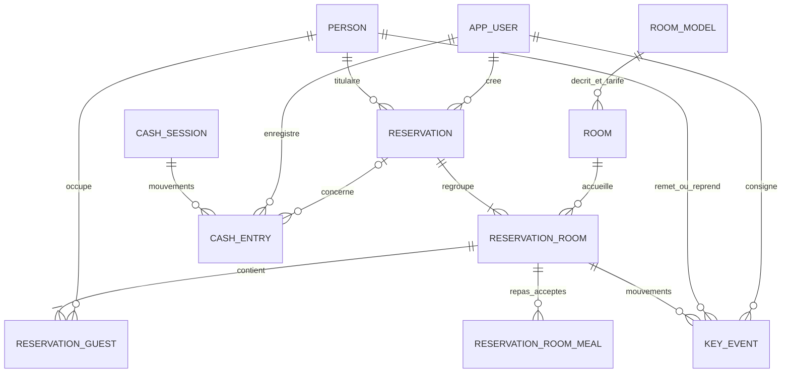

# Schéma complet de HotelSys

L’unique fichier **[001_initial.sql](../src/main/resources/db/migrations/001_initial.sql)** contient directement **13 tables et quatre vues calculées**, leurs index, les valeurs initiales et tous les triggers. Il s’exécute une seule fois sur une base vide ; aucune suite d’ALTER/DROP ni de migrations intermédiaires n’est nécessaire.

Le numéro SQLite `user_version=5` identifie ce format. En version 4, seules la vue de disponibilité et les contraintes concernées sont mises à jour. Il ne compte pas les fichiers de migration. La connexion et les transactions sont gérées par `Db`.

| Table | Rôle et relations |
|---|---|
| `hotel` | Configuration unique, services de restauration et préférences |
| `hotel_meal` | Trois lignes : code du repas et prix unique par personne/nuit |
| `room_model` | Nom, lits, enfants sans lit, liste d’équipements séparée par retours à la ligne, `nightly_price` |
| `room` | Numéro unique, `model_id`, activation ; aucun prix dupliqué |
| `person` | Identité, naissance, sexe, coordonnées facultatives, document textuel unique par type |
| `app_user` | Nom, identifiant interne, empreinte PBKDF2, rôle et activation ; un seul administrateur |
| `reservation` | Titulaire, réceptionniste créateur, date UTC et notes facultatives |
| `reservation_room` | Chambre, dates et heures locales, état, prix et capacité acceptés, vérification familiale |
| `reservation_guest` | Occupants de chaque séjour et besoin d’un lit |
| `reservation_room_meal` | Repas choisis et prix acceptés ; conserve aussi les anciens tarifs enfant |
| `cash_session` | Fond initial, auteur de l’ouverture/clôture, espèces comptées |
| `cash_entry` | Paiement/remboursement/dépense, montant, réservation, acteur et date UTC |
| `key_event` | Séjour, personne, acteur, date UTC, `TAKE`/`GIVE`, indicateur de retour définitif |

Les équipements n’exigent ni catalogue séparé ni liaison : l’interface ajoute/retire des éléments, stockés une fois sur le modèle. `room_model_meal` a été supprimée : les repas et leur prix ne dépendent plus du modèle. Les anciens champs de catégorie enfant restent dans les instantanés pour préserver les prix historiques ; les nouveaux repas utilisent le même prix par personne.

Les montants sont des entiers en centimes DZD, les dates `YYYY-MM-DD`, les heures `HH:mm` en Africa/Algiers et les événements en UTC. Les tables sont STRICT. Les identifiants et relations ont des clés étrangères et des index adaptés aux lectures par chambre, séjour, personne et session.

`room_totals`, `reservation_balances` et `cash_session_totals` calculent les montants sans table de compteurs. La vue `stay_timing` utilise l’heure de départ réservée jusqu’au départ effectif. Une fois le départ enregistré, la chambre est disponible trois heures après cet instant. Les triggers vérifient les conflits de chambre et d’occupant ainsi que les transitions. Un départ après l’arrivée le même jour est permis et facture une nuit au minimum. Les prolongations augmentent uniquement le départ, conservent les prix acceptés et vérifient les conflits dans la transaction.

Les écritures financières et mouvements de clés ne peuvent être modifiés ou supprimés. Les chambres avec historique se désactivent. Les comptes employés utilisés se désactivent ; le compte administrateur reste protégé.

Pour une base existante, `Db.initialize` crée une sauvegarde cohérente dans `data/backups`, lit le schéma canonique et recopie les colonnes compatibles dans une transaction. Les tables sont remplies avant l’installation des triggers, pour conserver les séjours déjà commencés ou terminés et les journaux immuables. Les identifiants, réservations et écritures financières sont conservés. Les clés étrangères et l’intégrité sont vérifiées avant le commit ; une erreur restaure l’ancienne base par rollback.

Les seules adaptations des bases anciennes sont : tarif de la première chambre vers son modèle si nécessaire ; tarif du premier modèle vers le repas global ; heures absentes à 14:00/11:00 ; conservation du premier administrateur actif. Les données déjà au format courant ne sont pas transformées. Aucune de ces conversions ne réécrit les prix acceptés d’un séjour.
