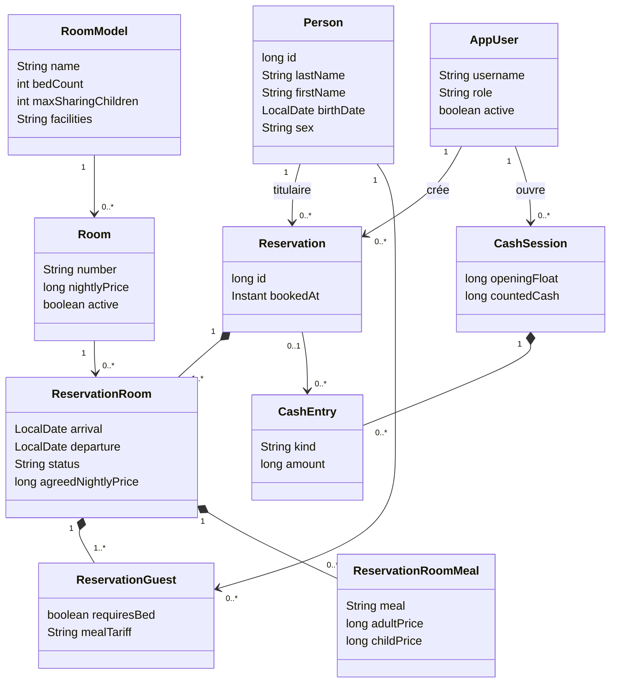

# UML et modèle relationnel

Ouvrir [HotelSys.mdj](HotelSys.mdj) dans StarUML. Le projet contient un diagramme de classes du domaine et un diagramme de cas d'utilisation avec réceptionniste et administrateur. Les attributs des classes sont issus du schéma SQL ; ce sont les concepts du domaine, pas une obligation de créer une classe Java par table.

Le modèle relationnel détaillé, les cardinalités et les contraintes se trouvent dans [database.md](../database.md). Le [script SQL](../../src/main/resources/db/migrations/001_initial.sql) reste la référence pour les évolutions.

Les notions adulte/enfant sont dérivées de la naissance et de la règle concernée : admission du titulaire, besoin d'un lit et prix des repas. Une sous-table adulte et une sous-table enfant ne sont pas nécessaires.

Le format natif a été construit à partir de la structure des [exemples officiels StarUML](https://github.com/staruml/staruml-samples) et vérifié pour l'unicité de ses identifiants et la résolution de toutes ses références. Son ouverture dans StarUML n'a pas été vérifiée sur ce poste.
